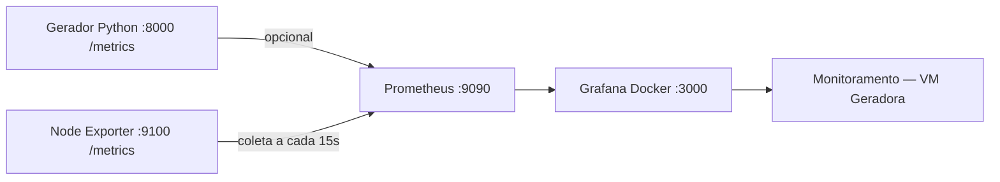

# Monitoramento da VM geradora

Implementação de Prometheus + Node Exporter + Grafana integrada ao Ansible.
O código está preparado para implantação. Nenhum playbook de configuração foi
executado nas VMs durante esta implementação.

## Arquitetura e ambiente identificado

O repositório e as consultas SSH somente de leitura confirmaram:

- As duas VMs usam Ubuntu Server 24.04; o OpenTofu mantém provisionamento,
  cloud-init, rede DHCP e geração de `infra/ansible/inventory.ini`.
- `devops-1`, grupo `monitoring`: Grafana em `/opt/monitoring/compose.yml`,
  container `monitoring-grafana-1`, porta 3000 e volume `monitoring_grafana_data`.
- `devops-2`, grupo `simulator`: projeto Compose existente em `/opt/simulator`,
  com PostgreSQL, API Flask/Gunicorn, gerador Python e Adminer.
- O gerador cria clientes, vendedores e estoque se as tabelas não existirem.
  Depois gera vendas, crediário e promoções em lotes a cada cinco segundos,
  injeta inconsistências intencionais e grava no PostgreSQL.
- Na inspeção inicial, Grafana e simulador estavam ativos; Prometheus e Node
  Exporter não estavam instalados. O UFW estava inativo nas duas VMs.



As setas representam o fluxo dos dados. O Prometheus inicia as requisições
HTTP à VM geradora; o Grafana consulta o Prometheus. Prometheus e Node Exporter
utilizam pacotes Ubuntu e seus serviços systemd. O Grafana existente permanece
em Docker, com a mesma imagem, senha e volume persistente.

O endereço da fonte do Grafana é `http://<ansible_host de monitoring>:9090`:
`localhost` dentro do container apontaria para o próprio Grafana. As sub-redes
Docker são descobertas por inspeção, sem endereços de bridge fixos.

## Aplicar em VMs já preparadas

Execute na raiz do repositório, depois de autorizar a implantação:

```bash
ansible-playbook -i infra/ansible/inventory.ini \
  infra/ansible/playbooks/monitoring.yml
```

Esse playbook instala os dois exporters/coletores de infraestrutura, configura
Prometheus e provisiona o Grafana existente. A imagem do Grafana não é baixada
novamente se já estiver disponível. A adição dos mounts de provisioning exige
recriar o container do Grafana uma vez; mudanças nas fontes/provedores exigem
reinício. O volume preserva usuários, senhas, dashboards e demais dados.

O fluxo completo continua disponível por `setup.yml`, que importa
`monitoring.yml` ao final. Não é necessário executar OpenTofu para adicionar
monitoramento às VMs existentes:

```bash
ansible-playbook -i infra/ansible/inventory.ini \
  infra/ansible/playbooks/setup.yml
```

Aplique aos dois grupos: limitar a execução a `monitoring` não instala o Node
Exporter na geradora e pode fazer o teste de disponibilidade falhar.

## Métricas da aplicação: implantação opcional

A instrumentação está em `simulator/metrics.py` e `stream_generator.py`.
O padrão `simulator_metrics_enabled: false` preserva a execução do container
atual. Para instalar a versão instrumentada e adicionar seu job ao Prometheus:

```bash
ansible-playbook -i infra/ansible/inventory.ini \
  infra/ansible/playbooks/monitoring.yml \
  -e simulator_metrics_enabled=true \
  -e simulator_compose_dir=/opt/simulator
```

`/opt/simulator` foi identificado nas labels do container em execução. A role
confere esse diretório antes de escrever. Copia apenas o gerador, seu módulo de
métricas e requisitos, com backup dos arquivos alterados; grava
`compose.metrics.yml` e executa `up --no-deps` somente para `generator`.
Banco, API, Adminer e volumes não são reiniciados. A versão dos arquivos fica em
uma label para que uma construção malsucedida seja repetida na próxima execução.

Essa opção reconstrói e reinicia o gerador na primeira aplicação. Para manter a
opção nas aplicações seguintes, configure `simulator_metrics_enabled` e
`simulator_compose_dir` em `infra/ansible/group_vars/all/monitoring.yml`, ou repita
os parâmetros. Nas operações manuais posteriores no gerador, mantenha os dois
arquivos Compose:

```bash
# Na geradora, dentro de /opt/simulator:
docker compose -f docker-compose.yml -f compose.metrics.yml ps
```

| Métrica | Significado |
| --- | --- |
| `simulator_records_generated_total{table}` | Registros gravados com sucesso, por tabela, desde o início do processo. |
| `rate(simulator_records_generated_total[1m])` | Taxa de registros por segundo, com tratamento de reinícios do contador. |
| `simulator_generation_errors_total{stage}` | Exceções na inicialização ou nos ciclos; não conta inconsistências sintéticas intencionais. |
| `simulator_ready` | 1 após inicialização/ciclo bem-sucedido, 0 após erro. |
| `simulator_last_success_timestamp_seconds` | Permite identificar geração parada mesmo com endpoint ativo. |
| `simulator_last_batch_sales` | Quantidade de vendas no último ciclo concluído. |
| `simulator_last_batch_sales_value_brl` | Soma dos valores gerados antes dos ruídos/duplicações sintéticos, no último ciclo concluído. |
| `simulator_generation_cycle_duration_seconds` | Histograma de duração dos ciclos, sem a pausa de cinco segundos. |

Os contadores não incluem o histórico anterior no banco e reiniciam junto com
o processo. Gravações parciais bem-sucedidas são contadas mesmo se uma tabela
posterior falhar. Não há consultas adicionais ao PostgreSQL. A observação de
valores não modifica os dataframes nem as rotinas de geração e gravação.
Falhas na abertura do endpoint HTTP são registradas e não interrompem o gerador.

O endpoint `/metrics` usa porta configurável: `simulator_metrics_port` no host,
8000 no container. A biblioteca permite `METRICS_PORT`, `METRICS_BIND_ADDRESS`,
`METRICS_ENABLED` e `METRICS_ALLOWED_SOURCES` fora do Compose. A publicação manual
pelo Compose do repositório fica em loopback por padrão; as variáveis
`SIMULATOR_METRICS_BIND`, `SIMULATOR_METRICS_PORT` e
`SIMULATOR_METRICS_ALLOWED_SOURCES` permitem configurar esse acesso.

## Segurança, preservação e idempotência

- A porta IPv4 9100 aceita somente o endereço de monitoramento do inventário.
  O Node Exporter escuta apenas no endereço privado da geradora.
- A porta IPv4 9090 aceita o host KVM (gateway da VM) e as sub-redes do container
  Grafana. Acesso local por loopback permanece disponível. Outros clientes devem
  ser adicionados a `prometheus_ui_allowed_sources` com seus IPs/CIDRs.
- A role `metrics_firewall` instala uma cadeia própria `MR-VM-METRICS` no INPUT
  do iptables, antes das regras existentes. Filtra apenas as portas indicadas
  em todas as interfaces IPv4; preserva SSH, Docker e todas as outras regras.
  A restrição vale inclusive se o UFW estiver inativo. Um serviço systemd
  reaplica a cadeia após reboot, depois do UFW e antes dos coletores.
- A publicação Docker de métricas da aplicação é protegida pela allowlist HTTP
  do próprio endpoint: somente o monitoramento recebe as métricas. Isso evita
  depender do UFW para portas publicadas pelo Docker, que seguem outro caminho
  no firewall. Não são criadas regras na cadeia DOCKER.
- Prometheus mescla sua configuração existente: preserva jobs não gerenciados,
  regras, alertas e opções globais; gerencia apenas `vm-geradora`,
  `aplicacao-geradora` e o intervalo global de coleta. Faz backup e valida o
  arquivo candidato com `promtool check config` antes de substituí-lo.
- Serviços systemd reiniciam por handlers somente se a configuração mudar.
  Templates, pacotes e regras são declarativos; jobs não são duplicados.
- A consulta somente de leitura ao SQLite do volume Grafana identifica fontes
  padrão da organização 1. A nova fonte só se torna padrão se não houver outra.
  Não usa a senha inicial, que pode ter sido alterada na interface.
- O provisioning usa UID estável, provedor separado e `disableDeletion: true`.
  Dashboards existentes permanecem no volume; a versão do novo dashboard é
  administrada pelos arquivos. Atualizações do JSON são detectadas a cada 15s.

As variáveis compartilhadas ficam em
`infra/ansible/group_vars/all/monitoring.yml`, junto ao inventário para descoberta
automática. Nenhum IP do laboratório está escrito nos templates ou nas roles.

## Acesso e dashboard

Consulte os endereços atuais no inventário ou com `tofu -chdir=infra/iac output ips`.
Na inspeção de **11/11/2026**, inventário, estado OpenTofu e SSH concordaram:

| Serviço | URL após implantação |
| --- | --- |
| Grafana, já existente | <http://192.168.122.119:3000> |
| Prometheus | <http://192.168.122.119:9090> |
| Targets do Prometheus | <http://192.168.122.119:9090/targets> |
| Dashboard | <http://192.168.122.119:3000/d/vm-geradora> |

Esses IPs são DHCP e servem apenas como registro do ambiente inspecionado.
A automação sempre utiliza o inventário. O acesso ao Prometheus é permitido
por padrão a partir do host KVM; inclua outros clientes na allowlist se preciso.

No Grafana, abra **Dashboards → Infraestrutura → Monitoramento — VM Geradora**.
O filtro **Instância** inclui todos os hosts do grupo `simulator`, mesmo quando
estão DOWN. Os painéis da aplicação acompanham a seleção da VM por uma variável
oculta; permanecem sem dados enquanto a instrumentação opcional não for aplicada.

O dashboard tem 20 painéis/linhas: CPU, RAM em percentual e bytes, RAM disponível,
disco por ponto de montagem, espaço disponível, rede recebida/transmitida, uptime,
operações de disco, disponibilidade e métricas do gerador. Atualiza a cada 15s.
`UP` significa coleta do endpoint disponível; a idade do último ciclo complementa
a disponibilidade do processo. As primeiras taxas precisam de algumas coletas.

Use as credenciais atuais do Grafana. A senha inicial, se ainda aplicável, está
preservada em `/opt/monitoring/grafana_admin_password` na VM de monitoramento.

## Validar depois da implantação

Na raiz do repositório:

```bash
ansible simulator -i infra/ansible/inventory.ini \
  -m ansible.builtin.command -a 'systemctl is-active prometheus-node-exporter'
ansible simulator -i infra/ansible/inventory.ini \
  -m ansible.builtin.command -a 'systemctl is-enabled prometheus-node-exporter'
ansible monitoring -i infra/ansible/inventory.ini \
  -m ansible.builtin.command -a 'systemctl is-active prometheus'
ansible monitoring -i infra/ansible/inventory.ini \
  -m ansible.builtin.command -a 'systemctl is-enabled prometheus'
ansible monitoring -i infra/ansible/inventory.ini --become \
  -m ansible.builtin.command -a 'promtool check config /etc/prometheus/prometheus.yml'
ansible monitoring -i infra/ansible/inventory.ini \
  -m ansible.builtin.uri \
  -a 'url=http://{{ hostvars[groups["simulator"][0]].ansible_host }}:9100/metrics'
ansible monitoring -i infra/ansible/inventory.ini \
  -m ansible.builtin.uri -a 'url=http://127.0.0.1:9090/api/v1/targets'
ansible monitoring -i infra/ansible/inventory.ini \
  -m ansible.builtin.uri -a 'url=http://127.0.0.1:3000/api/health'
ansible all -i infra/ansible/inventory.ini --become \
  -m ansible.builtin.command -a 'iptables -S MR-VM-METRICS'
```

A resposta de `/api/v1/targets` deve mostrar `health: up` para `vm-geradora`.
Se a opção da aplicação estiver ativa, também deve mostrar `aplicacao-geradora`.
O playbook já espera esses estados, verifica `/metrics` a partir do monitoramento,
testa a conexão ao Prometheus no namespace de rede do Grafana e confirma a fonte
e o dashboard carregados no SQLite do Grafana.

A verificação do dashboard contempla a tabela legada `dashboard` e o armazenamento
unificado `resource`. No Grafana 13+, a tabela legada pode ficar vazia ou conter
dados antigos; somente o recurso ativo do dashboard é considerado nessa versão.
Essa mudança está descrita no [guia de atualização do Grafana 13](https://grafana.com/docs/grafana/latest/upgrade-guide/upgrade-v13/upgrade-v13.0/).
O erro `Dashboard ausente` da verificação anterior foi reproduzido em testes com
SQLite e corrigido para o Grafana 13.3.1 identificado na VM.

Para consultar UP/DOWN a partir do host KVM com os IPs atualmente identificados:

```bash
curl -fsSG --data-urlencode 'query=up{job="vm-geradora"}' \
  http://192.168.122.119:9090/api/v1/query
```

Repita o mesmo comando de aplicação do Ansible para validar idempotência nas
VMs; sem alterações ou serviços parados, a segunda execução deve registrar
`changed=0`. Essa verificação exige autorização para executar o playbook.

## Validações locais e resultados

Verificações executadas em **11/11/2026**:

- `tofu fmt -check -diff` e `tofu validate`: passaram; nenhum arquivo OpenTofu foi alterado.
- `ansible-playbook --syntax-check`: passou para `setup.yml` e `monitoring.yml`.
- Inventário: endereços e grupos conferidos com o estado OpenTofu e com SSH.
- Renderização real pelo Ansible: jobs, Compose, firewall e provisioning válidos.
- `promtool` 2.45.3 do pacote oficial Ubuntu: configuração e todas as expressões
  PromQL do dashboard validadas; resultados conhecidos de CPU, RAM, disco,
  uptime e DOWN conferidos com séries sintéticas.
- Docker Compose: configuração do simulador, do Grafana e do override opcional
  verificadas sem iniciar containers.
- Testes Python: contadores, falhas parciais, preservação da pausa de 5s,
  valores sem mutação, estado/recuperação, endpoint HTTP, allowlist, configuração
  do Grafana e idempotência da cadeia de firewall.
- Mesclagem de configuração e renderização repetidas: nenhuma duplicação;
  segunda renderização sem mudanças nos arquivos.
- SSH somente de leitura: sistema operacional, processos, firewall, volume,
  fontes existentes e caminho do projeto Compose confirmados.

**Pendente de implantação autorizada:** instalação real, `UP` dos novos targets,
carregamento do novo dashboard no Grafana, comunicação dos novos serviços,
restrições reais de rede, persistência após reboot e idempotência completa nas
VMs. Nenhum `tofu apply`, playbook remoto ou comando destrutivo foi executado.

Para repetir as validações locais, com Ansible, PyYAML, `prometheus-client` e
`promtool` disponíveis no controlador:

```bash
ANSIBLE_LOCAL_TEMP=/tmp/pi-monitoring-ansible \
  ansible-playbook -i infra/ansible/inventory.ini monitoring/tests/render.yml
python3 -m unittest discover -s monitoring/tests -v
```

A validação `render.yml` usa conexão local e grava apenas em
`/tmp/pi-monitoring-validation`; não inclui as tarefas de implantação. Se o
`promtool` não estiver no PATH, informe `PROMTOOL=/caminho/promtool` ao executar
os testes. Sem ele, apenas o teste das consultas é marcado como ignorado.

## Arquivos da implementação

Modificados:

- `infra/ansible/playbooks/setup.yml`: template Compose compartilhado e importação do monitoramento.
- `simulator/stream_generator.py`, `requirements.txt`, `docker-compose.yml`: instrumentação e publicação configurável.
- `README.md` e `monitoring/README.md`: estado, implantação e operação.

Criados:

- `infra/ansible/group_vars/all/monitoring.yml`: variáveis e portas.
- `infra/ansible/playbooks/monitoring.yml`: execução independente nas VMs existentes.
- `infra/ansible/templates/monitoring-compose.yml.j2`: Compose único do Grafana.
- `infra/ansible/roles/node_exporter/`: `tasks/main.yml` e `handlers/main.yml`.
- `infra/ansible/roles/prometheus/`: `tasks/main.yml`, `tasks/merge.yml`,
  `handlers/main.yml` e `templates/jobs.yml.j2`.
- `infra/ansible/roles/grafana_provisioning/`: `tasks/main.yml`, `handlers/main.yml`,
  `templates/prometheus.yml.j2`, `templates/dashboards.yml.j2` e `templates/vm-geradora.json.j2`.
- `infra/ansible/roles/metrics_firewall/`: `tasks/main.yml`,
  `templates/metrics-firewall.py.j2` e `templates/vm-metrics-firewall.service.j2`.
- `infra/ansible/roles/simulator_metrics/`: `tasks/main.yml` e `templates/compose.metrics.yml.j2`.
- `simulator/metrics.py`: biblioteca de observação e endpoint protegido.
- `monitoring/tests/render.yml`, `test_configuration.py`, `test_metrics.py`: validações locais.

Referências primárias: [configuração do Prometheus](https://prometheus.io/docs/prometheus/latest/configuration/configuration/),
[provisioning do Grafana](https://grafana.com/docs/grafana/latest/administration/provisioning/),
[cliente Python do Prometheus](https://prometheus.github.io/client_python/exporting/http/)
e [firewall e portas Docker](https://docs.docker.com/engine/network/packet-filtering-firewalls/).
